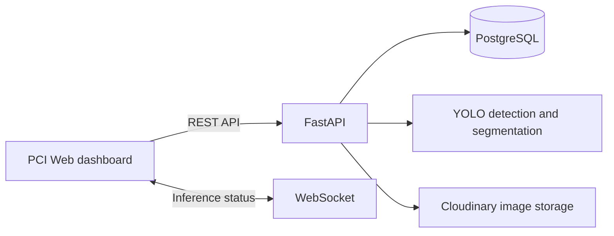

# PCI Server

FastAPI backend for pavement condition management. It provides authenticated APIs for pavement networks, sections, sample units, distress detection, PCI calculations, analytics, and report generation. YOLO models process uploaded sample-unit images, and inference progress is sent to clients over WebSockets.

## Architecture



## Requirements

- Python 3.13 (the version used by the included Dockerfile)
- PostgreSQL
- Cloudinary account credentials
- The YOLO weights in `app/vision_models/` (included in this repository)

## Local setup

Run these commands from the `PCI-server` directory. On Windows:

### 1. Create a virtual environment and install dependencies

```powershell
py -3.13 -m venv .venv
.\.venv\Scripts\Activate.ps1
python -m pip install --upgrade pip
pip install -r requirements.txt
```

On macOS or Linux, create and activate the environment with:

```sh
python3.13 -m venv .venv
source .venv/bin/activate
python -m pip install --upgrade pip
pip install -r requirements.txt
```

### 2. Configure environment variables

Create a `.env` file in the project root:

```dotenv
DATABASE_URL=postgresql://<user>:<password>@localhost:5432/<database>
SECRET_KEY=<a-long-random-secret>
FRONTEND_URL=http://localhost:5173
CLOUDINARY_CLOUD_NAME=<cloud-name>
CLOUDINARY_API_KEY=<api-key>
CLOUDINARY_API_SECRET=<api-secret>
```

`ALGORITHM` and `ACCESS_TOKEN_EXPIRE_MINUTES` are optional; they default to `HS256` and `30`. Keep real credentials out of version control.

### 3. Apply database migrations

Alembic reads `DATABASE_URL` from the process environment. In PowerShell, set it for the migration command:

```powershell
$env:DATABASE_URL = "postgresql://<user>:<password>@localhost:5432/<database>"
alembic upgrade head
```

### 4. Start the API

```powershell
uvicorn app.main:app --reload --host 127.0.0.1 --port 8000
```

The server loads both YOLO models during startup. Once it is running:

- Health check: <http://localhost:8000/>
- Interactive API documentation: <http://localhost:8000/docs>
- OpenAPI schema: <http://localhost:8000/openapi.json>

## API areas

| Area | Prefix | Purpose |
| --- | --- | --- |
| Authentication | `/api/auth` | Sign in, retrieve the current user, and change a password |
| Networks and sections | `/api/networks`, `/api/sections` | Manage road networks, sections, and sample units |
| Sample units and detections | `/api/sample-units`, `/api/detections` | Upload pavement images and manage detected distress |
| PCI | `/api/pci` | Calculate and retrieve PCI scores and history |
| Analytics | `/api/analytics` | Dashboard statistics, distributions, trends, and map data |
| Inference updates | `/ws/inference/{sample_unit_id}` | Receive live processing status |

Use `/docs` for request and response schemas, required authentication, and the complete endpoint list.

## Related project

The companion PCI-Web frontend consumes this API.
